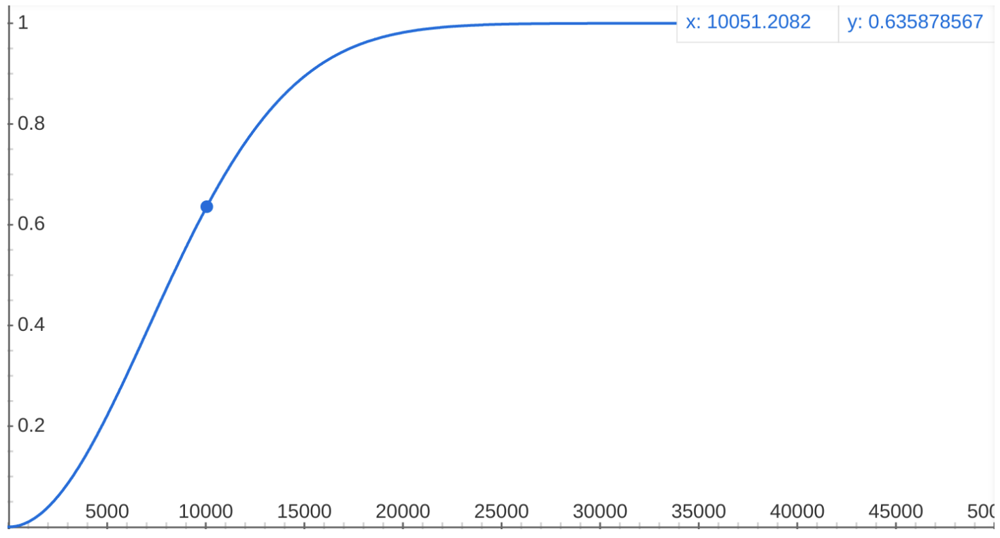

# Nodes Hardware Decentralization

The first factor for the evaluation of networks' decentralization is the _rate
of growth_ of the overall "nodes' hardware" connected to the network.

It is important to remark that this metric takes into account nodes' _"growth rate"_
rather than just nodes' _"absolute number"_, for the following reason: one could
easily say that 10 nodes are better than 1 node, or that 100 nodes are better than
10 nodes. But, are 1.5 millions nodes really _much better_ than 1 million nodes?

What we are trying to state here is that the number of nodes should be analyzed
as a _growth phenomenon_, that tends to reach a _steady state_ after which the
addition of other nodes do not really impact decentralization in a linear and proportional
way.

_Sigmoid functions_, like _Logistic function_ or _Error function_, are a good way
to model growth phenomena. Their characteristic _S_-shaped curve perfectly models
a system, like a network, that exhibits a progression from small beginnings, that
accelerates and approaches a climax over time.

_Cumulative Distribution_ functions, similarly, contain information on a phenomenon
regarding its growth or distribution before or after a certain _"inflection point"_.

We propose to model the **Nodes Hardware Decentralization** as a _Cumulative Distribution_:

\\[ d_{N} = 1 - e^{-\left(\frac{N}{\lambda}\right)^k} \\]

that can theoretically range from 0 (no hardware growth) to 1 (complete hardware
growth).

The parameters \\(k\\) and \\(\lambda\\) should be calibrated to best fit the growth
phenomenon with respect to the growth _"inflection point"_:

- \\(k\\) defines the speed of growth of the phenomenon;
- \\(\lambda\\) defines the order of magnitude of the inflection point for a given
growth phenomenon.

How to tune \\(\lambda\\) for a Blockchain network could be debated around the following
question:

**What is the reasonable order of magnitude of nodes at which we can say that a
Blockchain network has grown sufficiently?**

Our opinion is that a meaningful _decentralization "inflection point"_ for a Blockchain
network should be greater than a few dozens or a few hundreds nodes. In particular,
given the context of the analysis, we think adequate and reasonable to set:

- \\(k = 2\\) for the speed of growth;
- \\(\lambda = 10^4\\) for the inflection point magnitude.

\\[ d_{N} = 1 - e^{-\left(\frac{N}{10^4}\right)^2} \\]

## Counting the Nodes

Algorand nodes are pseudonymous: anyone can run one, and no registry lists
them. They can only be observed, from the relays they connect to: as of 2025,
each node keeps a connection to four relays at a time, and regularly swaps the
slowest for a random one. Counting the distinct IP addresses a few relays see
is no longer reliable: home nodes change address, and short-lived bots connect
and leave.

[Nodely](https://nodely.io/blog/algorand-node-counting/) estimates instead the
_full-time node equivalents_: a node online half of the time counts as half a
node. Every hour, a sample of relays records the nodes connected to them, and
the _Chao-1_ estimator infers from it how many nodes no relay saw.

### Chao-1 Estimator

Ecologists face the same problem when counting the species of an environment:
some are too rare to be found in a sample. Anne Chao's estimator uses the
rarest ones found to estimate those missed. Given the \\(S_{obs}\\) nodes
observed, of which \\(F_1\\) were seen by a single relay and \\(F_2\\) by
exactly two:

\\[ S_{Chao1} = S_{obs} + \frac{F_1^2}{2 F_2} \\]

Many nodes seen by a single relay mean many more were likely seen by none: the
estimate grows. Few of them mean the relays saw almost every node: it stays
close to \\(S_{obs}\\). For example, 2,000 nodes observed in an hour, 300 by a
single relay and 200 by two, estimate:

\\[ S_{Chao1} = 2000 + \frac{300^2}{2 \cdot 200} = 2225 \\]

The estimate is a lower bound, and does not depend on how many relays observe.
Nodely averages the hourly estimates over 7 days, to smooth out the hours of
the day.

> [!NOTE]
> The estimate counts IP addresses, not machines: nodes sharing an address
> (behind NAT) count as one, and nodes changing it within the hour as many.
> Nodes connected only to private relays are missed, and the relays observing
> may not be representative of the whole network.

### Full-Time Nodes on Algorand

The estimate ranged from about 1,200 to 3,700 full-time nodes since 2024: see
the [Nodely dashboard](https://g.nodely.io/d/network/network). With \\(\lambda = 10^4\\), that is a Nodes
Hardware Decentralization \\(d_N\\) between 0.01 and 0.13: how to calibrate
the inflection point remains an open question.

> [!NOTE]
> PPoS Dex v1 and v2 consider a _perfect_ Nodes Hardware Decentralization
> (\\( d_N = 1 \\)), leaving the refinement of the calculation of this
> decentralization factor to future works.
>
> [Community contribution are welcome!](https://github.com/cusma/pposdex)

## Node Versions

Algorand upgrades its consensus protocol when more than 90% of the
[stake](stake.md#nakamoto-coefficient) agrees. Nodes still running a version
that does not support the live protocol cannot follow the consensus anymore:
the share of nodes on an incompatible version tells how many fell behind the
last upgrade. Nodely's [upgrade stats](https://g.nodely.io/d/bea312nluusxse/upgrade-stats)
show it.
